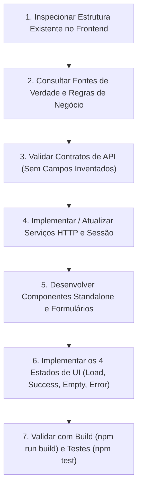

# Angular Frontend Skill

Guia operacional, arquitetural e normativo para agentes de IA e desenvolvedores atuando no frontend Angular da plataforma **E-Commerce de Drones**. Esta skill estabelece o fluxo de trabalho obrigatório, as convenções de código standalone, o tratamento de estados de interface, as regras de negócio client-side e limites operacionais estritos.

---

## 🎯 Objetivo e Escopo

Esta skill deve ser ativada para:
1. **Componentes Standalone**: Criação e refatoração de componentes (`standalone: true`), templates reativos com nova sintaxe de controle de fluxo (`@if`, `@for`, `@switch`) e estado local com **Angular Signals** (`signal`, `computed`).
2. **Rotas e Navegação**: Configuração de rotas em `app.routes.ts`, layouts (`AdminLayoutComponent`, `EcommerceLayout`), parâmetros dinâmicos, títulos de página e resolvers de dados.
3. **Formulários Reativos e Validação**: Construção de formulários tipados com `ReactiveFormsModule`, validações de formatos nacionais (CPF, CNPJ, CEP, telefone), seleção encadeada (Marca -> Modelo) e feedback acessível de erros.
4. **Serviços HTTP e Integração com API**: Consumo de endpoints da API Quarkus via `HttpClient`, paginação com `PagedResponse<T>`, parâmetros tipados (`HttpParams`) e observância do contrato unificado (`backend-response.md`).
5. **Modelos e Interfaces TypeScript**: Definição de contratos tipados em `core/models/` espelhando os DTOs do backend, sem adição de atributos não suportados.
6. **Autenticação, Guards e Sessão**: Gerenciamento de token JWT em `AuthService`, anexação de credenciais via interceptor HTTP e proteção de rotas (`authGuard`, controle RBAC para `ADMIN` vs `CLIENTE`).
7. **Telas de Listagem, Inclusão e Edição**: Tabelas dinâmicas (`MatTable`), paginação internacionalizada (`MatPaginator`), modais de confirmação (`ConfirmDialogComponent`), formulários de criação e pré-carregamento para edição.
8. **Validação de Qualidade e Build**: Verificação de compilação sem erros (`npm run build`) e execução de testes unitários com Vitest (`npm test`).

---

## ⛔ Limites Claros e Ações Proibidas (Guardrails)

> [!CRITICAL]
> **O agente DEVE respeitar os seguintes limites inegociáveis:**
> 
> 1. ❌ **NÃO Alterar o Backend**: É expressamente proibido modificar arquivos no diretório `backend/` (Controllers, Services, Repositories, Entidades JPA, SQL ou pom.xml) sem solicitação e autorização prévia e explícita do usuário.
> 2. ❌ **NÃO Alterar Dependências do Projeto**: Não instale novos pacotes npm nem altere versões no `frontend/package.json` sem autorização explícita do usuário. Reutilize as bibliotecas já instaladas (Angular Material, Angular CDK, Tailwind CSS 4, RxJS).
> 3. ❌ **NÃO Alterar Contratos de API**: Não altere endpoints, estruturas de payload de entrada/saída ou convenções de resposta JSON sem autorização formal.
> 4. ❌ **NÃO Inventar Endpoints ou Campos**: Todo endpoint chamado pelo frontend DEVE existir previamente no backend Quarkus. Todo atributo de modelo TypeScript DEVE corresponder a um campo existente nos DTOs do backend.
> 5. ❌ **NÃO Armazenar Dados Sensíveis**: É proibido salvar dados de cartão de crédito (número do cartão, CVV) em `localStorage`, `sessionStorage` ou registrá-los em logs do console.
> 6. ❌ **NÃO Executar Ações Destrutivas sem Confirmação**: Exclusões de registros devem obrigatoriamente abrir o diálogo de confirmação (`ConfirmDialogComponent`) antes de chamar a API.

---

## 🔄 Fluxo de Trabalho Obrigatório do Agente

Ao receber qualquer tarefa de frontend, execute rigorosamente as 7 etapas abaixo:



### 1. Inspecionar o Projeto Antes de Criar ou Modificar Arquivos
- Analise a pasta `frontend/src/app/` para identificar padrões adotados.
- Verifique se já existem modelos em `core/models/`, serviços em `core/services/` ou componentes similares em `features/admin/` ou `features/ecommerce/`.
- Reutilize utilitários compartilhados em `shared/` (como `ConfirmDialogComponent` e `custom-paginator-intl.ts`).

### 2. Consultar as Fontes de Verdade
Antes de codificar, leia atentamente a documentação fundamental:
- [**`frontend/AGENTS.md`**](../../frontend/AGENTS.md): Convenções do módulo frontend Angular 22.
- [**`docs/CONTEXTO_PROJETO.md`**](../../docs/CONTEXTO_PROJETO.md): Stack, arquitetura monorepo e roadmap de pendências.
- [**`docs/REGRAS_NEGOCIO.md`**](../../docs/REGRAS_NEGOCIO.md): Regras de domínio (limite de 5 imagens de drone, cálculo de desconto promocional, integridade marca/modelo, estoque).
- [**`docs/modelo.plantuml`**](../../docs/modelo.plantuml): Diagrama de classes do domínio com atributos e relacionamentos.
- [**`frontend/docs/backend-response.md`**](../../frontend/docs/backend-response.md): Padrão de respostas JSON da API (`data`, `meta`, `error.details`).

### 3. Garantir Ausência de Endpoints ou Campos Inventados
- Certifique-se de que cada endpoint invocado existe em `backend/src/main/java/drones/resources/`.
- Assegure-se de que os campos de envio e recebimento correspondem aos Records DTO em `backend/src/main/java/drones/dto/`.
- Caso falte algum dado na API para atender a tela, **não simule respostas fictícias nem crie rotas fantasmas**: informe a dependência ao usuário.

### 4. Implementar ou Atualizar Serviços HTTP e Estado de Sessão
- Serviços devem ser `@Injectable({ providedIn: 'root' })`.
- Utilize `HttpClient` tipado explicitamente com `Observable<T>` ou `Observable<PagedResponse<T>>`.
- Parâmetros de consulta devem ser montados de forma limpa via `HttpParams`.
- Autenticação deve utilizar o token gerenciado em `AuthService`.
- Consulte o guia completo em [**`references/http-services-contracts.md`**](references/http-services-contracts.md).

### 5. Construir Componentes Standalone e Formulários Reativos
- Declare sempre `standalone: true` e liste os módulos necessários no `imports: [...]`.
- Adote **Angular Signals** (`signal`, `computed`) para gerenciar reatividade local e flags de estado.
- Utilize a nova sintaxe de templates nativa (`@if`, `@for ... track`, `@empty`, `@switch`).
- Utilize `ReactiveFormsModule` tipado com `FormBuilder`.
- Valide formatos brasileiros (CPF, CNPJ, CEP, telefone) e regras de domínio (ex: seleção encadeada Marca -> Modelo).
- Consulte os guias:
  - [**`references/standalone-components-patterns.md`**](references/standalone-components-patterns.md)
  - [**`references/reactive-forms-validation.md`**](references/reactive-forms-validation.md)

### 6. Tratar Rigorosamente os 4 Estados de Interface
Qualquer fluxo assíncrono deve contemplar:
1. **Carregando (Loading)**: `mat-spinner` ou skeletons Tailwind com botões de ação desabilitados.
2. **Sucesso (Success)**: Notificação amigável via `MatSnackBar` e redirecionamento ou atualização de dados.
3. **Vazio (Empty)**: Apresentação amigável com ícone, mensagem descritiva e botão para nova ação.
4. **Erro (Error)**: Mapeamento de erros de validação (HTTP 400) diretamente nos campos do formulário via `control.setErrors({ serverError: issue })` e alertas claros para 401, 403, 404 e 500.
- Consulte o guia completo em [**`references/ui-states-and-checklist.md`**](references/ui-states-and-checklist.md).

### 7. Validar com Testes e Build de Produção
- Execute os testes unitários do frontend:
  ```bash
  cd frontend
  npm test
  ```
- Execute o build do projeto para garantir zero erros de TypeScript e sintaxe de templates:
  ```bash
  cd frontend
  npm run build
  ```
- Ao finalizar com sucesso, atualize o status da funcionalidade em `docs/CONTEXTO_PROJETO.md` se aplicável.

---

## 📚 Documentação de Referência Rápida

Consulte os guias especializados na pasta `references/` conforme o contexto da tarefa:

| Arquivo de Referência | Finalidade | Quando Consultar |
| :--- | :--- | :--- |
| [**`references/standalone-components-patterns.md`**](references/standalone-components-patterns.md) | Estrutura standalone, Signals, `@if`/`@for`, Angular Material e Tailwind CSS 4. | Ao criar ou estilizar novos componentes e layouts. |
| [**`references/reactive-forms-validation.md`**](references/reactive-forms-validation.md) | Formulários reativos, validações brasileiras, seleção encadeada e mapeamento de erros 400. | Ao implementar ou editar formulários de inclusão/edição. |
| [**`references/http-services-contracts.md`**](references/http-services-contracts.md) | Serviços com `HttpClient`, contratos padronizados (`PagedResponse`), JWT e Guards. | Ao criar ou alterar integração com endpoints da API. |
| [**`references/ui-states-and-checklist.md`**](references/ui-states-and-checklist.md) | Guia visual dos 4 estados de UI, controle de acesso RBAC e checklist de revisão. | Durante a revisão de código, validação de telas e testes. |
