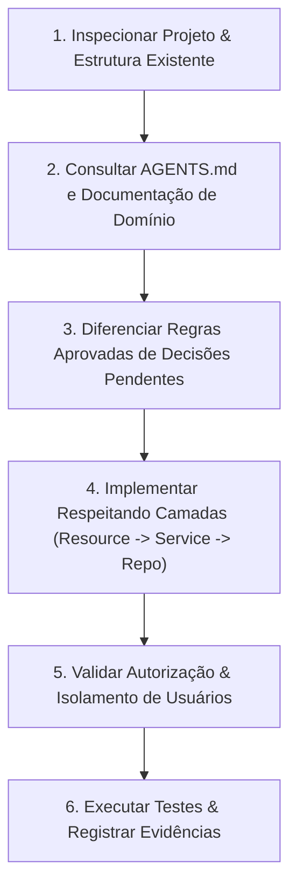

# Quarkus Backend Skill

Guia operacional e normativo para agentes de IA e desenvolvedores atuando no backend Java com Quarkus. Esta skill estabelece o fluxo de trabalho obrigatório, a arquitetura em camadas, as diretrizes de segurança e os limites operacionais estritos para garantir código manutenível, seguro e perfeitamente integrado ao domínio do projeto.

---

## 🎯 Objetivo e Escopo

Esta skill deve ser ativada para:
1. **Criação ou Alteração de Endpoints REST**: Definição de rotas JAX-RS, métodos HTTP semânticos, cabeçalhos, status codes e contratos de entrada/saída.
2. **Implementação de Camadas**:
   - `Resources` (`*Controller.java` JAX-RS com `@ApplicationScoped`).
   - `Services` (`*ServiceInterface.java` e `*Service.java` com regras de negócio e `@Transactional`).
   - `Repositories` (`*Repository.java` implementando `PanacheRepository<T>`).
   - `Entities` (`*Entity.java` herdando de `PanacheEntityBase`).
3. **Contratos DTO e Mappers**: Java Records (`*RequestDTO`, `*ResponseDTO`) e mapeamento bidirecional estático (`*Mapper.java`).
4. **Validações e Exceções**: Bean Validation (`@Valid`, `@NotNull`, `@NotBlank`, etc.) e lançamento de `ValidationException("mensagem", "campo")`.
5. **Revisão de Código Backend**: Auditoria de segurança (JWT, RBAC, isolamento de usuários/tenants), integridade relacional e prevenção de vazamento de entidades JPA.
6. **Execução de Testes e Coleta de Evidências**: Validação da compilação (`./mvnw compile`) e execução de suites de teste (`./mvnw test`).

---

## ⛔ Limites Claros e Ações Proibidas (Guardrails)

O agente **NÃO TEM AUTORIZAÇÃO** para:
- ❌ **Alterar Regras de Negócio** sem aprovação prévia e explícita do usuário.
- ❌ **Modificar Entidades JPA, Tabelas ou Migrations/Seeds (`import.sql`)** sem validação formal e alinhamento com o diagrama de domínio.
- ❌ **Inventar Endpoints, Parâmetros ou Regras Não Especificadas**: Toda funcionalidade deve derivar estritamente da especificação aprovada.
- ❌ **Retornar Entidades JPA Diretamente pela API**: É expressamente proibido expor classes `@Entity` no retorno de métodos JAX-RS. Sempre utilize `*ResponseDTO`.
- ❌ **Acessar Repositories Diretamente no Resource**: O Resource deve comunicar-se exclusivamente com a interface do Service (`*ServiceInterface`).
- ❌ **Burlar o Isolamento de Usuários/Tenants**: Nunca confie em IDs de usuário enviados no corpo da requisição ou query params para operações de perfil próprio; utilize sempre `jwt.getName()`.
- ❌ **Trafegar ou Armazenar Dados Sensíveis em Texto Plano**: Senhas devem usar hash BCrypt; dados de cartão e chaves privadas nunca devem ser logados ou expostos.

---

## 🔄 Fluxo de Trabalho Obrigatório do Agente

Ao receber qualquer tarefa de backend, execute impreterivelmente as 6 etapas abaixo:



### 1. Inspecionar o Projeto Antes de Alterar Arquivos
- Localize o diretório de trabalho (`backend/`).
- Mapeie as classes existentes no pacote do domínio correspondente (`drones.resources`, `drones.services`, `drones.repository`, `drones.model`, `drones.dto`, `drones.mapper`).
- Verifique se já existem DTOs, mappers ou métodos semelhantes para evitar duplicação de código e inconsistências de nomenclatura.

### 2. Consultar as Fontes de Verdade e Documentação
Antes de codificar, leia os documentos centrais:
- [**`backend/AGENTS.md`**](../../backend/AGENTS.md): Convenções do módulo backend Quarkus.
- [**`docs/CONTEXTO_PROJETO.md`**](../../docs/CONTEXTO_PROJETO.md): Visão geral, stack e roadmap.
- [**`docs/REGRAS_NEGOCIO.md`**](../../docs/REGRAS_NEGOCIO.md): Regras de negócio, fluxos e validações obrigatórias.
- [**`docs/modelo.plantuml`**](../../docs/modelo.plantuml): Diagrama de classes JPA e integridade referencial.
- [**`frontend/docs/backend-response.md`**](../../frontend/docs/backend-response.md): Contrato padronizado de payloads JSON da API.

### 3. Identificar Regras Aprovadas e Decisões Pendentes
- **Regras Aprovadas**: Documentadas formalmente em `docs/REGRAS_NEGOCIO.md` (ex: máximo de 5 imagens por drone, snapshot de endereço na criação de pedidos, devolução automática de estoque no cancelamento). Devem ser implementadas à risca.
- **Decisões Pendentes**: Se a solicitação do usuário tocar em pontos não documentados, ambíguos ou em itens do Roadmap em aberto, **NÃO ASSUMA COMPORTAMENTOS**. Apresente a dúvida de forma clara antes de codificar.

### 4. Implementar na Arquitetura em Camadas
Siga a cadeia estrita de responsabilidades:
```
[HTTP Request]
       │
       ▼
[Resource (Controller)]   <-- JAX-RS, @Valid, @RolesAllowed, extrai JWT, chama Service
       │
       ▼
[Service (Interface)]     <-- Contrato desacoplado (*ServiceInterface.java)
       │
       ▼
[Service (Impl)]          <-- Regras de negócio, @Transactional, ValidationException
       │
       ▼
[Repository (Panache)]    <-- PanacheRepository<T>, HQL/Panache queries customizadas
       │
       ▼
[Entity (Panache/JPA)]    <-- PanacheEntityBase, mapeamento relacional, validações JPA
       │
       ▼
[Mapper Estático]         <-- Converte Entity <-> Record DTO (*Mapper.java)
       │
       ▼
[HTTP Response]          <-- Response HTTP (200, 201, 204) ou PageResponse<T>
```

Consulte [Architecture & Layer Rules](./references/architecture-rules.md) para detalhes completos de cada camada.

### 5. Validar Autorização e Isolamento de Usuários
- Proteja endpoints com as anotações adequadas:
  - Administrativos: `@RolesAllowed("ADMIN")`.
  - Cliente Autenticado: `@RolesAllowed({"CLIENTE", "ADMIN"})` ou `@Authenticated`.
  - Públicos: Sem anotação de role (ex: catálogo público, cadastro público de cliente, login).
- **Isolamento de Tenants/Usuários**:
  - Injete `JsonWebToken jwt`.
  - Obtenha o usuário logado via `String login = jwt.getName()`.
  - Nunca aceite um `usuarioId` arbitrário vindo do cliente para alterar dados próprios (endereços, favoritos, pedidos). Valide se o recurso acessado pertence de fato ao usuário autenticado.

Consulte [Security and Isolation Guide](./references/security-and-isolation.md).

### 6. Executar Testes e Registrar Evidências
- Valide a integridade do código executando os comandos a partir de `backend/`:
  ```bash
  # Compilação estrita com JDK 25:
  ./mvnw compile

  # Execução dos testes automatizados:
  ./mvnw test

  # Execução de teste específico (se aplicável):
  ./mvnw test -Dtest=NomeDoTesteTest
  ```
- **Registrar Evidências**:
  - Capture e relate o resultado da compilação e execução dos testes no resumo de conclusão.
  - Caso haja falhas, corrija a causa raiz antes de finalizar a resposta.

---

## 📌 Documentos de Referência Rápida

- [**Regras de Arquitetura e Camadas**](./references/architecture-rules.md): Especificação de Resources, Services, Repositories, DTOs, Mappers e Transações.
- [**Segurança, JWT e Isolamento**](./references/security-and-isolation.md): Diretrizes contra IDOR, perfis de acesso, SmallRye JWT e proteção de dados.
- [**Checklist de Revisão e Pré-Voo**](./references/review-checklist.md): Roteiro para auto-revisão antes de entregar qualquer alteração.
- [**Templates e Exemplos de Código**](./references/examples-templates.md): Modelos canônicos de código para cada artefato backend.

---

## 🔄 Regra de Ouro: Sincronização da Documentação

Sempre que a tarefa envolver:
1. **Nova regra de negócio ou alteração de regra existente**: Atualize imediatamente [**`docs/REGRAS_NEGOCIO.md`**](../../docs/REGRAS_NEGOCIO.md).
2. **Alteração em tabelas, colunas, enums ou entidades**: Atualize imediatamente [**`docs/modelo.plantuml`**](../../docs/modelo.plantuml) e `backend/src/main/resources/import.sql`.
3. **Mudança no status de funcionalidades ou decisões técnicas**: Atualize [**`docs/CONTEXTO_PROJETO.md`**](../../docs/CONTEXTO_PROJETO.md).
