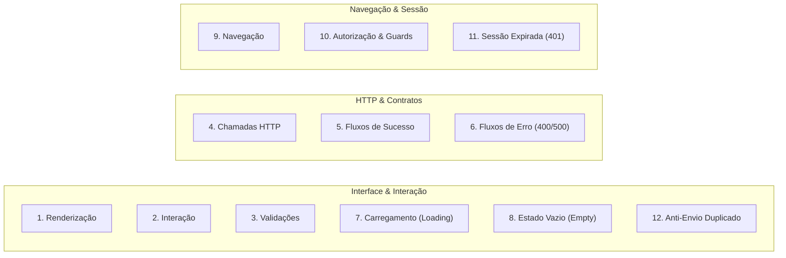
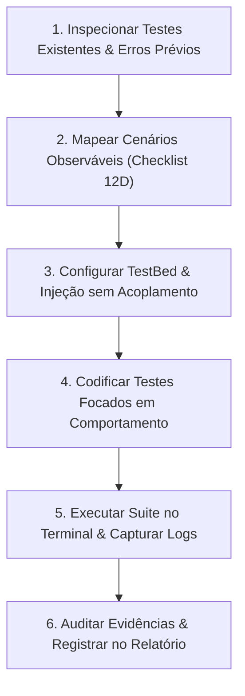

# Testes Frontend Angular Skill

Guia normativo e operacional para agentes de IA e desenvolvedores responsáveis por criar, manter, executar e auditar a suite de testes automatizados do frontend Angular 22 (com Vitest, JSDOM e Angular Testing Utilities).

Esta skill prioriza **comportamento observável do usuário** e **evidências reais de execução**, proibindo aprovações nominais ou suposições de cobertura sem validação concreta no terminal.

---

## 🎯 Objetivo e Escopo

Esta skill deve ser obrigatoriamente ativada para:
1. **Criação de Testes Unitários e de Integração**:
   - Componentes Standalone (renderização, reatividade com Signals, templates com `@if` e `@for`).
   - Formulários Reativos (validações síncronas/assíncronas, regex CPF/CNPJ/CEP/telefone, mensagens `mat-error`, submit disabled).
   - Serviços HTTP (consumo com `HttpTestingController`, contratos `data`, `meta` e `error.details` de `backend-response.md`).
   - Roteamento e Navegação (`provideRouter`, transições de rota, parâmetros de rota).
   - Guards Funcionais (`authGuard`, controle de acesso por roles `ADMIN` / `CLIENTE`).
   - Interceptores HTTP (`authInterceptor`, anexo de header `Authorization: Bearer <token>`, detecção de 401 e logout).
   - Modais e Diálogos (`MatDialogRef`, `MAT_DIALOG_DATA`, `ConfirmDialogComponent`).
2. **Revisão e Auditoria de Testes Existentes**:
   - Eliminação de testes "ocos" (que apenas executam `expect(component).toBeTruthy()` sem assertar comportamento).
   - Correção de injeções de dependência faltantes (`ActivatedRoute`, `HttpClient`, animações).
   - Identificação de falsos positivos (testes que passam mas não testam a regra) e falsos negativos.
3. **Execução de Testes e Coleta Estrita de Evidências**:
   - Execução em modo não interativo (`ng test --watch=false`).
   - Registro mandatório da saída do terminal comprovando aprovação real.
4. **Prevenção e Diagnóstico de Regressões**:
   - Isolamento de testes de arquivos específicos via `--include`.
   - Diagnóstico de falhas de timing assíncrono em Signals e Observables.

---

## ⛔ Regras Inegociáveis e Ações Proibidas (Guardrails)

O agente **NÃO TEM AUTORIZAÇÃO** para:
- ❌ **Declarar Cobertura ou Aprovação sem Evidência Real**: É expressamente proibido afirmar "todos os testes passaram" ou "cobertura completa" sem executar o comando de teste no terminal e inspecionar a saída real.
- ❌ **Criar Testes Ocos / Triviais**: Nenhum teste deve conter apenas `expect(component).toBeTruthy()`. Todo teste deve validar ao menos um comportamento observável (DOM, evento, chamada externa ou estado visual).
- ❌ **Pular ou Suprimir Testes Quebrados**: É proibido renomear testes para `xit()`, `fit()`, `describe.skip()` ou comentar testes para mascarar quebras na suite.
- ❌ **Mockar Tudo a Ponto de Esvaziar o Teste**: Nunca substitua o componente real por um stub completo. Mocks devem ser aplicados nas fronteiras de I/O (serviços HTTP, dialogs externos, `Router`), mantendo a lógica interna do componente intacta.
- ❌ **Utilizar Tipagem `any` nos Dados de Teste**: Dados de payload, modelos e mocks devem seguir estritamente as interfaces TypeScript de `src/app/core/models/`.
- ❌ **Ignorar Erros de Injeção de Dependência**: Erros como `NG0201: No provider found for ActivatedRoute` ou `HttpClient` não devem ser ignorados nem silenciados com hacks; configure os providers de teste apropriados (`provideRouter([])`, `provideHttpClientTesting()`).

---

## 🧭 As 12 Dimensões de Cobertura de Comportamento Observável

Todo conjunto de testes de uma funcionalidade deve buscar cobrir as seguintes 12 dimensões:



1. **Renderização Inicial**: Componente exibe títulos, rótulos, botões esperados e classes Tailwind corretas de acordo com as propriedades iniciais.
2. **Interação do Usuário**: Disparo de eventos reais (`click`, `input`, `change`) e reflexo imediato no DOM ou em Signals reativos.
3. **Validações de Formulário**: Bloqueio de submissão quando inválido, exibição de mensagens de erro específicas (`mat-error`, regex CPF/CNPJ/CEP) e habilitação quando válido.
4. **Chamadas HTTP**: Verificação de método (GET, POST, PUT, DELETE), URL de endpoint, parâmetros de query e body enviado via `HttpTestingController`.
5. **Fluxos de Sucesso**: Renderização dos dados retornados em `response.data`, exibição de snackbar ou feedback de sucesso e fechamento de modais.
6. **Fluxos de Erro da API**: Respostas com status 400 mapeando `error.details` nos campos do formulário via `setErrors({ serverError: ... })`, e status 500 exibindo mensagem amigável ao usuário.
7. **Estado de Carregamento (Loading)**: Spinners (`mat-progress-spinner`) ou skeletons visíveis enquanto requisições estão pendentes; botões desabilitados durante o carregamento.
8. **Estado Vazio (Empty State)**: Exibição clara de mensagem indicando ausência de dados quando arrays retornam vazios (`data: []`).
9. **Navegação**: Redirecionamento correto via `Router.navigate` após ações concluídas (ex: após login bem-sucedido ou cadastro de drone).
10. **Autorização & Guards**: Rotas administrativas bloqueando usuários não autenticados ou clientes comuns, permitindo apenas role `ADMIN`.
11. **Sessão Expirada (HTTP 401)**: Interceptor capturando erro 401, limpando `localStorage` e redirecionando para `/login`.
12. **Prevenção de Envio Duplicado (Double Submit)**: Desativação do botão de submissão e flag de bloqueio durante o processamento de uma requisição, garantindo que múltiplos cliques rápidos não gerem requisições concorrentes duplicadas.

Consulte a matriz detalhada em [Observable Behavior Checklist](./references/observable-behavior-checklist.md).

---

## 🔄 Fluxo de Trabalho Obrigatório do Agente (6 Etapas)



### 1. Inspecionar Testes Existentes e Erros Prévios
- Verifique se o arquivo `*.spec.ts` já existe para o componente/serviço.
- Inspecione se os testes atuais são apenas esqueletos gerados pelo CLI (`should create`) ou se possuem dependências quebradas.
- Execute o teste existente isoladamente para capturar o ponto de partida:
  ```bash
  npx ng test --watch=false --include="**/nome-do-componente.spec.ts"
  ```

### 2. Mapear Cenários com Foco em Comportamento Observável
- Baseie os cenários nas regras de negócio de [**`docs/REGRAS_NEGOCIO.md`**](../../docs/REGRAS_NEGOCIO.md) e nos contratos de [**`frontend/docs/backend-response.md`**](../../frontend/docs/backend-response.md).
- Defina explicitamente casos de sucesso, falha de validação, erro de rede, estado de loading e prevenção de envio duplicado.

### 3. Configurar o TestBed sem Dependências Quebradas
- Componentes Standalone: declare no array `imports: [MeuComponente]`.
- Forneça os providers obrigatórios para evitar falhas clássicas do Angular:
  - Rotas: `provideRouter([])` (evita `NG0201: No provider found for ActivatedRoute`).
  - HTTP: `provideHttpClient()`, `provideHttpClientTesting()`.
  - Animações Material: `provideNoopAnimations()`.
- Mocke apenas fronteiras externas (`vi.fn()` para métodos de serviços injetados).
- Consulte [Troubleshooting and DI Guide](./references/troubleshooting-and-di.md).

### 4. Codificar os Testes Focando em Interação e Estado do DOM
- Utilize `fixture.nativeElement` e `fixture.debugElement.query(By.css(...))` para inspecionar o que o usuário vê.
- Dispare eventos nativos (`button.click()`, `input.dispatchEvent(new Event('input'))`).
- Atualize a view com `fixture.detectChanges()` e aguarde o término de microtarefas/Signals com `await fixture.whenStable()`.
- Consulte [Testing Patterns Guide](./references/testing-patterns.md) para templates de código prontos.

### 5. Executar a Suite no Terminal e Capturar Resultados Reais
- **Nunca presuma que o teste passou**. Execute o comando:
  ```bash
  # Teste isolado do arquivo modificado:
  npx ng test --watch=false --include="**/meu-componente.spec.ts"

  # Suite completa de testes frontend:
  npm test -- --watch=false
  ```
- Se houver falha, inspecione a stack trace exata, corrija a causa raiz (não apenas o teste) e execute novamente até obter 100% verde.

### 6. Auditar e Registrar Evidências
- No fechamento de qualquer tarefa envolvendo frontend, forneça um bloco estruturado de evidência real:
  - **Comando executado**: Ex: `npx ng test --watch=false --include="**/drone-form.spec.ts"`
  - **Resumo**: `X test files passed (X passed, 0 failed)`
  - **Duração**: Tempo medido pelo Vitest
  - **Cenários Cobertos**: Lista dos `it(...)` comprovadamente executados.

---

## 🛠️ Comandos de Execução Rápida

| Objetivo | Comando |
| :--- | :--- |
| **Executar Suite Completa (Headless / CI)** | `npm test -- --watch=false` |
| **Executar Teste de Arquivo Específico** | `npx ng test --watch=false --include="**/drone-form.spec.ts"` |
| **Executar Testes de uma Feature Inteira** | `npx ng test --watch=false --include="**/features/admin/**"` |
| **Executar Teste por Nome/Regex (`-t`)** | `npx ng test --watch=false --test-name-pattern="should submit"` |
| **Verificar Integridade de Tipagem/Build** | `npm run build` |

---

## 📚 Documentos de Referência Especializados

- [**Padrões de Teste e Modelos Prontos**](./references/testing-patterns.md): Exemplos completos para Componentes, Signals, Formulários, Serviços HTTP, Guards e Interceptors.
- [**Checklist das 12 Dimensões de Comportamento Observável**](./references/observable-behavior-checklist.md): Guia de validação comportamental passo a passo.
- [**Guia de Resolução de Problemas e Injeção de Dependência**](./references/troubleshooting-and-di.md): Como resolver erros comuns no Angular 22 com Vitest (`NG0201`, Signals assíncronos, timers).
- [**Padrão de Evidência e Execução**](./references/evidence-and-execution.md): Diretrizes para captura e apresentação de logs reais de teste.

---

## 🔄 Regra de Ouro: Sincronização e Documentação

Sempre que adicionar ou alterar testes que revelem ou modifiquem comportamentos do sistema:
1. Se impactar regras de negócio: atualize [**`docs/REGRAS_NEGOCIO.md`**](../../docs/REGRAS_NEGOCIO.md).
2. Se impactar status de entrega ou roadmap: atualize [**`docs/CONTEXTO_PROJETO.md`**](../../docs/CONTEXTO_PROJETO.md).
3. Nunca encerre uma alteração deixando testes quebrando na suite principal.
