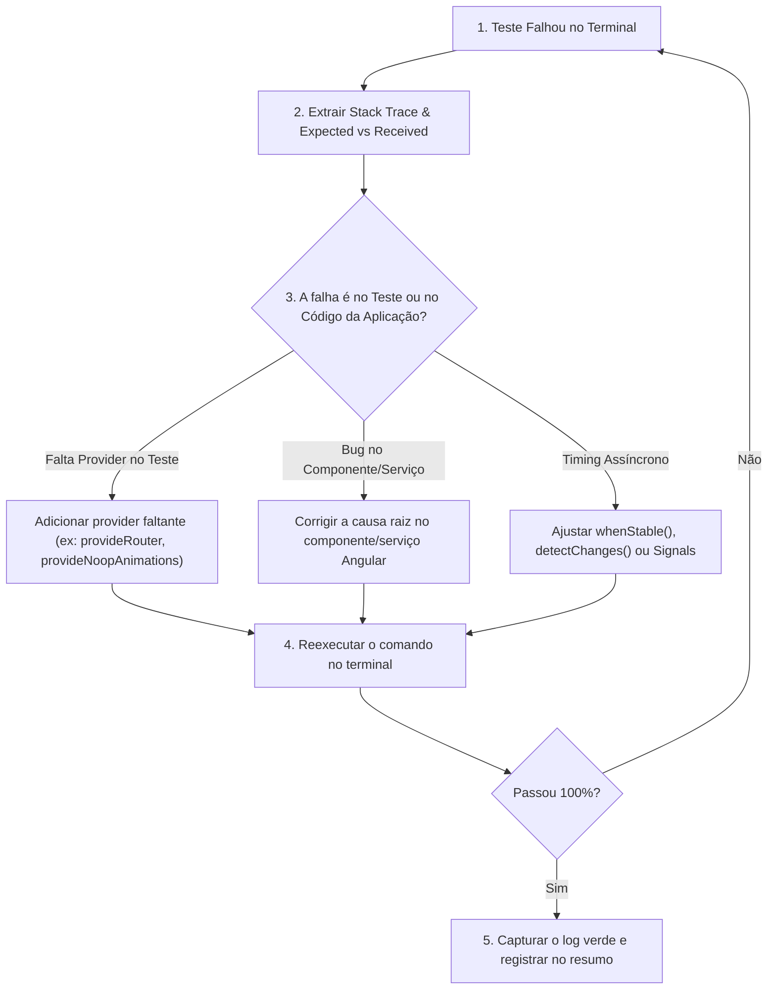

# Padrão de Evidência e Execução de Testes Frontend

Este documento define os procedimentos de execução, formatos de coleta e as regras obrigatórias de evidência para validação de testes no frontend Angular.

---

## 1. 🛡️ A Regra de Ouro da Evidência Estrita

> **REGRA MANDATÓRIA**: O agente NUNCA deve declarar cobertura, aprovação de testes ou ausência de regressões sem ter executado os testes no terminal e capturado a saída real gerada pelo Vitest.

### O que é Proibido:
- ❌ Dizer: *"Testes implementados e todos passaram perfeitamente"* sem rodar o comando e sem mostrar o log.
- ❌ Assumir que o código compila ou funciona porque *"a sintaxe TypeScript parece correta"*.
- ❌ Marcar uma tarefa como concluída se o terminal registrar `FAIL` ou saída com código de saída diferente de 0 (`exit code != 0`).

---

## 2. 📋 Comandos Oficiais de Execução

No diretório `frontend/`:

### Executar a Suite Completa em Modo Único (Headless):
```bash
npm test -- --watch=false
```

### Executar Teste de um Arquivo Específico:
```bash
npx ng test --watch=false --include="**/features/admin/components/drone-form/drone-form.spec.ts"
```

### Executar um Grupo de Testes por Padrão de Diretório:
```bash
# Todos os testes de admin:
npx ng test --watch=false --include="**/features/admin/**"

# Todos os testes de auth:
npx ng test --watch=false --include="**/features/auth/**"
```

### Filtrar Testes por Nome do Cenário (`--test-name-pattern`):
```bash
npx ng test --watch=false --test-name-pattern="deve desabilitar botão"
```

---

## 3. 📝 Formato Obrigatório do Bloco de Evidência

Ao concluir qualquer tarefa que envolva implementação, refatoração ou revisão de testes no frontend, o agente deve incluir no resumo final o bloco de evidência no formato abaixo:

```markdown
### 📊 Evidência de Execução de Testes Frontend

- **Comando Executado**: `npx ng test --watch=false --include="**/drone-form.spec.ts"`
- **Resultado do Runner**: `Test Files  1 passed (1)` | `Tests  4 passed (4)`
- **Duração**: `2.34s`
- **Status da Compilação**: `Application bundle generation complete. [Zero erros]`

#### Cenários Validados com Sucesso:
1. `✓ deve renderizar o formulário com campos iniciais vazios`
2. `✓ deve desabilitar o botão de salvar quando campos obrigatórios estiverem ausentes`
3. `✓ deve evitar submissão duplicada ao clicar rapidamente no botão salvar`
4. `✓ deve exibir mensagens de validação 400 retornadas pela API no formulário`
```

---

## 4. 🛠️ Procedimento em Caso de Falha de Teste

Se o comando retornar `FAIL` ou `exit code 1`:



1. **Extrair a Falha Exata**: Leia o trecho `Expected` vs `Received` e a linha do arquivo indicada no log.
2. **Identificar a Causa Raiz**:
   - Falta de Provider: `NG0201` -> adicionar `provideRouter([])`, `provideHttpClientTesting()`, etc.
   - Asserção quebrada: Verificar se a regra de negócio mudou ou se o componente possui um bug.
   - Dessincronia assíncrona: Inspecione se o componente estava com estado de loading ativo no momento da asserção.
3. **Corrigir**: Faça o ajuste cirúrgico necessário.
4. **Reexecutar**: Rode novamente o teste e confirme se a suite ficou verde.
