# Guia Rápido de Sintaxe e Padrões PlantUML

Este documento serve como referência rápida para estruturação de diagramas de classes em PlantUML no padrão adotado pelo projeto.

---

## 1. Configurações Globais Recomendadas (`skinparam`)

Mantenha o cabeçalho dos diagramas padronizado para clareza visual e legibilidade:

```plantuml
@startuml
title E-Commerce de Drones - Modelo de Classes

skinparam classAttributeIconSize 0
skinparam packageStyle rectangle
skinparam linetype ortho
skinparam shadowing false
skinparam roundcorner 5
hide empty methods
```



- `classAttributeIconSize 0`: Substitui os ícones coloridos por símbolos padrão UML (`-`, `+`, `#`, `~`).
- `linetype ortho`: Força linhas ortogonais (retas em ângulo reto), facilitando leitura em diagramas densos.
- `hide empty methods`: Oculta caixas vazias de métodos quando a classe possui apenas atributos.

---

## 2. Declaração de Entidades e Tipos

### Classes Concretas e Abstratas
```plantuml
package "drones.model.pedido" {
    abstract class Pagamento {
        - id: Long
        - valor: BigDecimal
        - statusPagamento: StatusPagamento
        - pedido: Pedido
    }

    class PagamentoPix {
        - chavePix: String
    }
}
```

### Enumerações
```plantuml
package "drones.model.usuario" {
    enum Perfil {
        ADMIN
        CLIENTE
    }
}
```

### Classes com Métodos de Domínio
```plantuml
class Pedido {
    - id: Long
    - dataPedido: LocalDateTime
    - valorTotal: BigDecimal
    + calcularValorTotal(): void
}
```

---

## 3. Notação Semântica de Relacionamentos

### Composição (`*--`)
Ciclo de vida dependente; exclusão em cascata; a parte não tem sentido existir sem o todo.
```plantuml
Pedido "1" *-- "1..*" ItemPedido : itens
Drone "1" *-- "0..5" DroneImage : imagens
Cidade "1" *-- "0..*" Endereco : enderecos
```

### Agregação (`o--`)
Ciclo de vida independente; existência autônoma; relação frouxa de agrupamento ou catálogo.
```plantuml
Fornecedor "1" o-- "0..*" Drone : fornece
Promocao "0..1" o-- "0..*" Drone : aplica-se-a
```

### Associação Direcionada (`-->`, `<--`)
Conhecimento unilateral ou chave estrangeira direta.
```plantuml
Drone "0..*" --> "1" Marca : marca
Drone "0..*" --> "1" Modelo : modelo
Usuario "1" --> "0..*" Pedido : historico
Usuario --> Perfil
```

### Generalização / Herança (`<|--`)
```plantuml
Pagamento <|-- PagamentoPix
Pagamento <|-- PagamentoCartao
```

---

## 4. Cardinalidades Padronizadas

Sempre declare as cardinalidades entre aspas em ambas as extremidades ou na extremidade destino:

- `"1"` : Exatamente um (obrigatório, `nullable = false`).
- `"0..1"` : Zero ou um (opcional, `nullable = true`).
- `"1..*"` : Um a muitos (coleção obrigatória de pelo menos 1 item).
- `"0..*"` : Zero a muitos (coleção padrão `List<T>` / `Set<T>`).
- `"0..N"` : Limite máximo documentado de cardinalidade (ex: `"0..5"`).

Exemplo:
```plantuml
Marca "1" *-- "0..*" Modelo : modelos
Drone "0..*" --> "0..1" Camera : camera
```

---

## 5. Notas Explicativas e Restrições de Domínio

Para documentar regras de negócio críticas diretamente no diagrama, utilize notas:

```plantuml
note right of Drone
  Regra: Limite de até 5 imagens.
  Regra: Se possuir câmera, o modelo
  deve pertencer à mesma marca.
end note

note bottom of Pedido
  Snapshot imutável de endereço
  gravado no momento da compra.
end note
```
